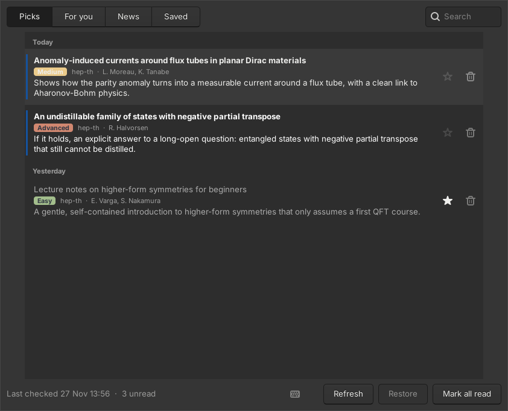
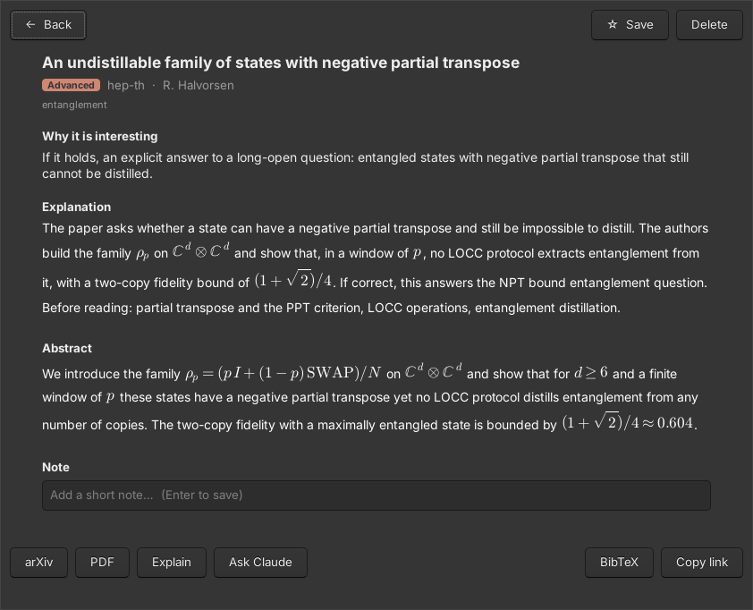

# Physics Digest

A small Linux desktop app that reads the new arXiv listings every day, lets Claude pick the few papers worth your time, and keeps them in a calm, keyboard-friendly reading list, with equations rendered properly.



*Screenshots show made-up example papers and authors.*

## Why

arXiv posts dozens of papers a day in each category. Physics Digest turns that into a short daily list:

- **Picks**: Claude reads the day's new titles and abstracts and chooses a handful for *you*, based on a short profile you write. Not only papers close to your own research, but also conceptually interesting ones and good reviews or lecture notes you can actually follow. Each pick comes with a one-line reason and a difficulty level (Easy, Medium, Advanced).
- **For you**: the best keyword matches of the day that Claude didn't already pick.
- **News**: a couple of stories a day from physics news feeds such as Quanta Magazine and APS Physics.
- **Saved**: your reading list.

It is deliberately minimal: by default you see about ten new items a day, not a hundred.

## Features

- **Background service** that starts with your session, checks a few times a day and sends desktop notifications. It uses about 20 MB of memory and no CPU while waiting.
- **Detail page** for every paper: why it was picked, the full abstract with **LaTeX math rendered** (Computer Modern), and a personal note.
- **Explain**: Claude explains the paper in a few sentences at your level and lists the concepts to know before reading.
- **Ask Claude**: opens a new Claude chat about the paper, with a link and context already written.
- **PDF**: downloads the paper to `~/Papers` and opens it in your PDF viewer.
- **BibTeX**: copies the arXiv BibTeX entry to the clipboard.
- **Keyboard first**: `j`/`k`, `Enter`, `S`, `O`, `P`, `E`, `B`, `A`, `Del`, `Esc`.
- **Readable layout**: text stays in a comfortable column at any window width; unread items are marked; day headers group the list.
- Delete what you don't want, and **Restore** brings back the latest day's deleted items.



## Requirements

- Linux with a desktop notification server (Xfce, GNOME, KDE, …). Developed on Xubuntu 26.04.
- Python 3.10+, PyGObject with GTK 3, librsvg.
- Optional: matplotlib and numpy for rendering equations (without them, equations are shown as readable Unicode text).
- Optional but recommended: [Claude Code](https://claude.com/claude-code), signed in, for Picks, Explain and the "why" summaries. It needs a Claude plan that includes Claude Code. Without it, Physics Digest still works with keyword matching.

## Install

```sh
git clone https://github.com/harunbsmc/physics-digest.git
cd physics-digest
./install.sh
```

On Debian/Ubuntu the installer installs the dependencies with `apt` (it asks for your password). It then puts `physics-digest` in `~/.local/bin`, adds a menu entry and a login autostart entry, and starts the background service.

Then edit `~/.config/physics-digest/config.json`. The most important part is your `profile`; see [Configuration](#configuration).

To update, `git pull` and run `./install.sh` again; your settings and data are kept.

## Usage

Open **Physics Digest** from your app menu, click a notification, or run `physics-digest`.

| Key | Action |
| --- | --- |
| `j` / `k` | move down / up the list |
| `Enter` | open the selected item |
| `Esc` | back to the list (closes the window from the list) |
| `S` | save or unsave |
| `O` | open on arXiv |
| `P` | download and open the PDF |
| `E` | explain with Claude |
| `B` | copy BibTeX |
| `A` | ask Claude in a new chat |
| `Del` | delete |
| `Ctrl+F` / `Ctrl+R` | search / refresh |

### Commands

```
physics-digest               open the window
physics-digest --tab NAME    open on a tab: picks, foryou, news, saved
physics-digest --refresh     ask the background service to check now
physics-digest --restore     bring back the latest day's deleted items
physics-digest --reset       forget everything and start fresh
physics-digest --daemon      run the background service (started automatically at login)
physics-digest --quit        stop the background service
```

### Optional Xfce panel item

`physics-digest-panel` prints an icon and the unread count for the Xfce **Generic Monitor** panel plugin. Add a Generic Monitor to your panel and set its command to `~/.local/bin/physics-digest-panel` (period 30 s, label off).

## Configuration

`~/.config/physics-digest/config.json` (created from `config.example.json` on first install):

| Key | Meaning |
| --- | --- |
| `profile` | A few sentences about you: field, level, research, curiosities. Claude uses it for Picks, Explain and Ask Claude. |
| `arxiv_categories` | arXiv categories to follow, e.g. `["hep-th", "quant-ph", "gr-qc"]`. |
| `keywords` | Words that make a paper relevant, in four weights: `core` (3), `broad` (2), `accessible` (2, e.g. "lecture notes"), `related` (1). Matching is case-insensitive and on parts of words ("anomal" matches "anomaly" and "anomalous"). |
| `authors` | Authors whose papers always rank high. |
| `min_score` | Minimum keyword score for "For you". |
| `news_feeds` | Name → RSS/Atom URL. |
| `claude_summary` | Use Claude for daily picks (`true`/`false`). |
| `claude_picks` | Picks per day (default 5). |
| `foryou_per_day` | "For you" items per day (default 3). |
| `news_per_day` | News items per day (default 2). |
| `check_every_hours` | How often the service checks (default 3). |
| `papers_dir` | Where PDFs are downloaded (default `~/Papers`). |
| `ask_claude_url` | URL opened by Ask Claude; `{prompt}` is replaced by the message. Use `claude://claude.ai/new?q={prompt}` to open the Claude desktop app instead of the browser. |

Changes are picked up at the next check.

## How it works

- arXiv publishes new listings once per weekday (no announcements on weekends and some holidays), so most days bring one batch. The service reads the arXiv RSS feeds, scores each new paper by your keywords and authors, and, if Claude is available, sends the titles and the start of each abstract together with your profile to `claude -p` to choose the picks.
- Everything is stored locally in `~/.local/share/physics-digest/items.db` (SQLite). Deleted items are remembered so they don't come back.
- The background service has no GUI libraries loaded; the window is a separate process that exits when you close it.

## Privacy

Physics Digest talks to arXiv, your news feeds and, if you use Claude features, to Claude through your own Claude Code installation. What is sent to Claude: your profile and the titles and abstracts of new papers (for Picks), or one paper's details (for Explain and Ask Claude). Nothing else leaves your computer, and there is no telemetry.

## Uninstall

```sh
./uninstall.sh            # remove the app, keep settings and saved items
./uninstall.sh --purge    # remove everything (your ~/Papers folder is never touched)
```

## License

MIT. See [LICENSE](LICENSE).

Physics Digest is not affiliated with arXiv or Anthropic. Thank you to arXiv for use of its open access interoperability.
